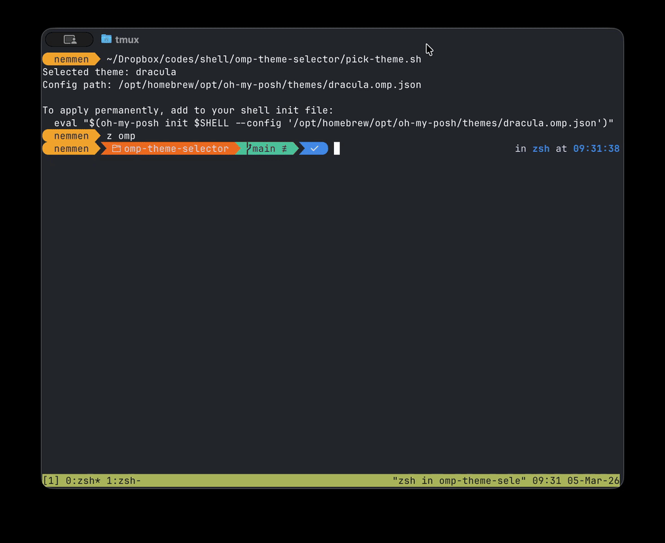

# omp-theme-selector

Interactive [oh-my-posh](https://ohmyposh.dev/) theme picker with live preview in the terminal.



## Features

- Browse all installed themes by name in an fzf picker
- Live preview of each theme rendered at the bottom of the terminal
- Resize or hide the preview with `Ctrl-/`
- Optionally preview every segment, including ones hidden by the current context
- Blinking cursor showing exactly where the prompt ends
- Works with Homebrew, curl installer, and custom theme directories
- Copy a Bash/Zsh setup command, or return just the config path for scripting

## Requirements

- [oh-my-posh](https://ohmyposh.dev/docs/installation/linux)
- [fzf](https://github.com/junegunn/fzf)
- Bash 3.2 or newer to run the picker; setup instructions support Bash and Zsh

## Installation

### Try without installing

Run once, without copying anything to your PATH:

```bash
bash <(curl -fsSL https://raw.githubusercontent.com/rsnemmen/omp-theme-selector/main/omp-theme.sh)
```

This launches the theme picker directly from GitHub — nothing is written to disk. `fzf` and `oh-my-posh` still need to be available.

### One-liner (recommended)

```bash
curl -fsSL https://raw.githubusercontent.com/rsnemmen/omp-theme-selector/main/install.sh | bash
```

This downloads `omp-theme` to `~/.local/bin` (or `/usr/local/bin`) and makes it executable.

To install to a custom writable location, set `INSTALL_DIR`:

```bash
curl -fsSL https://raw.githubusercontent.com/rsnemmen/omp-theme-selector/main/install.sh | INSTALL_DIR=~/bin bash
```

## Usage

```bash
omp-theme
```

Use `↑`/`↓` to browse themes and see them previewed instantly. Press `Enter` to select.
Press `Esc` or `Ctrl-C` to cancel without changing anything.
Press `Ctrl-/` to cycle the preview between 40% height, 80% height, and hidden.

```bash
omp-theme --themes-dir ~/my-themes --shell zsh
omp-theme --force
omp-theme --print-path
omp-theme --help
```

| Option | Behavior |
| --- | --- |
| `--themes-dir DIR` | Browse this directory instead of discovering a theme source |
| `--shell bash\|zsh` | Override the shell detected from `$SHELL` for setup instructions |
| `--force` | Render all segments regardless of the current directory or environment |
| `--print-path` | Print only the selected absolute config path to stdout |
| `-h`, `--help` | Show help, even when dependencies are missing |

In path-only mode, cancellation produces no stdout and exits successfully.
Errors produce a nonzero exit status, with diagnostics on stderr.

On selection the script prints the config path and the line to add to your shell init file:

```
Selected theme: agnoster
Config path: /opt/homebrew/opt/oh-my-posh/themes/agnoster.omp.json

To apply permanently, replace your existing Oh My Posh init line
or add this to ~/.zshrc:
  eval "$(oh-my-posh init zsh --config '/opt/homebrew/opt/oh-my-posh/themes/agnoster.omp.json')"
```

The picker prints instructions for Bash or Zsh based on the basename of `$SHELL`.
Use `--shell` if your active shell differs from your login shell. For an unknown
or unset shell, it prints the selected path and links to the upstream setup guide.
The picker does not edit your shell profile.

## Theme directory detection

The script looks for themes in this order:

1. `--themes-dir DIR` — explicit command-line override
2. `$POSH_THEMES_PATH` — explicit environment override
3. `~/.poshthemes/` — custom/user-managed themes
4. `$(oh-my-posh cache path)/themes` — curl installer (Linux & macOS)
5. `$(brew --prefix oh-my-posh)/themes` — Homebrew (Linux & macOS)

Explicit overrides must contain readable theme files. Automatic discovery skips
missing or empty directories and selects the first source with readable themes.
Only that source is shown; sources are not merged.

The picker supports `.omp.json`, `.omp.yaml`, and `.omp.toml` files, including
valid file and directory symlinks. Homebrew's stable `opt` paths are preserved
so printed configuration paths continue to work after upgrades. Paths containing
tabs or newlines are rejected because they cannot be represented in the picker.

If `fzf` or `oh-my-posh` is missing, `omp-theme` exits with a clear error. If no theme directory or theme files are found, it reports the missing path/source instead of opening an empty picker.

The picker uses local theme files. Update Oh My Posh and its bundled themes using
your installation method; for Homebrew, run `brew update && brew upgrade oh-my-posh`.
Custom theme directories are managed by you. See the upstream
[upgrade guide](https://ohmyposh.dev/docs/installation/upgrade) for other installation methods.

## Development and compatibility checks

Run the isolated regression suite with Python 3 (standard library only):

```bash
python3 -m unittest discover -s tests -v
shellcheck omp-theme.sh install.sh tests/smoke.sh
```

To also check real Oh My Posh initialization and rendering, install `fzf`,
`oh-my-posh`, and `zsh`, then pass the directory containing official themes:

```bash
bash tests/smoke.sh "$(brew --prefix oh-my-posh)/themes"
```

GitHub Actions runs on pushes, pull requests, manual dispatch, and each Monday.
It checks Linux and macOS (including system Bash 3.2), with real CLI smoke tests
against both Oh My Posh v31.9.1 and the latest stable release. Each smoke job uses
the binary and themes from the same release and logs the resolved versions.
